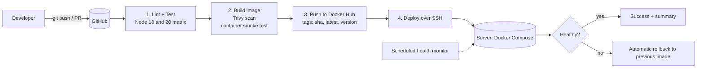

# CI/CD Pipeline Automation System


**Cognevance Technologies | Cloud Computing & DevOps | Level 2 (Intermediate)**
**Author:** YOUR NAME | **Docker Hub:** https://hub.docker.com/r/DOCKERHUB_USER/task-tracker | **Live app:** http://YOUR_SERVER_IP

A complete CI/CD pipeline that takes a web application from `git push` to a running Docker container: lint, test, build, scan, smoke-test, publish to Docker Hub, deploy to a server, verify, and roll back automatically if the new version is unhealthy.

---

## Table of contents
1. [Project overview](#1-project-overview)
2. [Pipeline architecture](#2-pipeline-architecture)
3. [Technology stack](#3-technology-stack)
4. [Repository structure](#4-repository-structure)
5. [The sample application](#5-the-sample-application)
6. [Run and test locally](#6-run-and-test-locally)
7. [Docker setup](#7-docker-setup)
8. [CI/CD pipeline explained](#8-cicd-pipeline-explained)
9. [Setup guide: secrets, registry and server](#9-setup-guide-secrets-registry-and-server)
10. [Deployment scripts](#10-deployment-scripts)
11. [Monitoring logs and deployment status](#11-monitoring-logs-and-deployment-status)
12. [Rollback strategy](#12-rollback-strategy)
13. [Security practices](#13-security-practices)
14. [Jenkins alternative](#14-jenkins-alternative)
15. [Troubleshooting](#15-troubleshooting)
16. [Task completion checklist](#16-task-completion-checklist)
17. [Deliverables](#17-deliverables)
18. [Screenshots](#18-screenshots)
19. [Setup checklist before submitting](#19-setup-checklist-before-submitting)
20. [Lessons learned and future improvements](#20-lessons-learned-and-future-improvements)

---

## 1. Project overview
| Item | Detail |
|---|---|
| Goal | Automate build, test and deployment of an application |
| App | Task Tracker (Node.js/Express REST API + web UI) |
| CI/CD | GitHub Actions (Jenkinsfile provided as alternative) |
| Containers | Docker multi-stage image, Docker Compose on server |
| Registry | Docker Hub |
| Target | Any Ubuntu server with SSH (e.g. AWS EC2 free tier) |
| Observability | Structured JSON logs, health checks, job summaries, scheduled health monitor |

## 2. Pipeline architecture



Pull requests run stages 1 and 2 only. Pushes to `main` run all four stages.

## 3. Technology stack
| Area | Tool |
|---|---|
| Application | Node.js 20, Express |
| Testing | Node built-in test runner with coverage |
| CI/CD | GitHub Actions (also Jenkins) |
| Containers | Docker, multi-stage build, Docker Compose |
| Registry | Docker Hub |
| Security scan | Trivy |
| Deployment | SSH + Bash scripts |
| Monitoring | Docker health checks, JSON logs, GitHub job summaries |

## 4. Repository structure
```
cognevance_cicd-pipeline-automation/
├── app/
│   ├── src/app.js, server.js     # Express API, logging, graceful shutdown
│   ├── public/                   # Web UI (HTML, CSS, JS)
│   ├── test/app.test.js          # 6 automated tests
│   └── package.json
├── Dockerfile                    # Multi-stage, non-root, healthcheck
├── docker-compose.yml            # Server deployment (hardened)
├── docker-compose.dev.yml        # Local build and run
├── scripts/
│   ├── deploy.sh                 # Pull, start, health check, auto-rollback
│   ├── rollback.sh               # Redeploy a previous tag
│   ├── status.sh                 # Deployment status
│   ├── logs.sh                   # follow / errors / slow / last N
│   ├── smoke-test.sh             # End-to-end API check
│   └── server-setup.sh           # One-time Docker install on server
├── .github/workflows/
│   ├── ci-cd.yml                 # Main pipeline
│   └── health-monitor.yml        # Scheduled production health check
├── jenkins/Jenkinsfile           # Alternative pipeline
├── docs/REPORT.md, docs/screenshots/
└── README.md, LICENSE, .gitignore, .dockerignore
```

## 5. The sample application
**Task Tracker**: add, complete and delete tasks through a responsive web UI or REST API.

| Method | Endpoint | Purpose |
|---|---|---|
| GET | `/health` | Liveness check used by Docker and monitors |
| GET | `/version` | Version, commit SHA and build date baked in at build time |
| GET | `/api/tasks` | List tasks |
| POST | `/api/tasks` | Create task `{ "title": "..." }` |
| PATCH | `/api/tasks/:id` | Mark done `{ "done": true }` |
| DELETE | `/api/tasks/:id` | Delete task |

Design points relevant to CI/CD: input validation, JSON structured logs, graceful shutdown on `SIGTERM` (so redeploys do not drop requests), `/version` so you can prove which commit is running. Data is held in memory, which keeps the demo simple; use a database for real workloads.

## 6. Run and test locally
```bash
git clone https://github.com/USERNAME/cognevance_cicd-pipeline-automation.git
cd cognevance_cicd-pipeline-automation

# Tests
cd app && npm install && npm test && cd ..

# Run without Docker
cd app && npm start            # http://localhost:3000

# Run with Docker
docker compose -f docker-compose.dev.yml up --build
./scripts/smoke-test.sh http://localhost:3000
```

## 7. Docker setup
- **Multi-stage build:** stage 1 installs production dependencies, stage 2 copies only what is needed, giving a small image.
- **Non-root user** (`USER node`) and no dev dependencies or test files in the image.
- **Build arguments** `APP_VERSION`, `GIT_SHA`, `BUILD_DATE` are stored as image labels and exposed on `/version`.
- **HEALTHCHECK** calls `/health` every 15 seconds; `deploy.sh` waits for the `healthy` state.
- **Compose hardening:** read-only filesystem, all Linux capabilities dropped, `no-new-privileges`, log rotation (10 MB x 5 files), `restart: unless-stopped`.

Manual build and push:
```bash
docker build -t DOCKERHUB_USER/task-tracker:1.0.0 --build-arg GIT_SHA=$(git rev-parse HEAD) .
docker login && docker push DOCKERHUB_USER/task-tracker:1.0.0
```

## 8. CI/CD pipeline explained
File: `.github/workflows/ci-cd.yml`

| Stage | Job | What happens |
|---|---|---|
| 1 | `test` | Runs on Node 18 and 20 (matrix): install, syntax lint, 6 tests with coverage, results written to the job summary |
| 2 | `build` | Builds the image (with layer cache), scans with Trivy for HIGH/CRITICAL CVEs, starts the container and runs `smoke-test.sh` against it |
| 3 | `publish` | Pushes to Docker Hub with tags `sha-xxxxxxx`, `latest` (main) and the Git tag for releases (`v1.0.0`) |
| 4 | `deploy` | Copies compose file and scripts to the server, runs `deploy.sh` (health check + rollback), then smoke-tests from outside |

Triggers: push to `main`, tags `v*`, pull requests (stages 1-2), manual run.
Stage 4 is protected by the `production` environment (add required reviewers for manual approval) and only runs when repository variable `DEPLOY_ENABLED=true`.

## 9. Setup guide: secrets, registry and server

### 9.1 Docker Hub
1. Create an account and a repository named `task-tracker`.
2. Account Settings > Security > **New Access Token** (Read & Write). Copy it.

### 9.2 Server (AWS EC2 free tier example)
1. Launch Ubuntu 22.04 `t2.micro`/`t3.micro`; security group: allow **22** (SSH, ideally your IP only) and **80** (HTTP).
2. SSH in and run `scripts/server-setup.sh` (installs Docker), then log out and in again.
3. Create a dedicated deploy key on your computer: `ssh-keygen -t ed25519 -f deploy_key -N ""`. Append `deploy_key.pub` to `~/.ssh/authorized_keys` on the server.

> No server? You can still submit a working pipeline: stages 1-3 run without one and prove build, test, scan and registry push. Run the app locally with Docker for your demo screenshots.

### 9.3 GitHub secrets and variables
Settings > Secrets and variables > Actions

| Type | Name | Value |
|---|---|---|
| Secret | `DOCKERHUB_USERNAME` | Docker Hub username |
| Secret | `DOCKERHUB_TOKEN` | Docker Hub access token |
| Secret | `SSH_PRIVATE_KEY` | Contents of `deploy_key` |
| Secret | `SERVER_HOST` | Server public IP or DNS |
| Secret | `SERVER_USER` | `ubuntu` |
| Variable | `DEPLOY_ENABLED` | `true` (after the server is ready) |

Also create an Environment named `production` (Settings > Environments); optionally add yourself as required reviewer.

### 9.4 First run
```bash
git add . && git commit -m "feat: initial CI/CD pipeline" && git push origin main
```
Watch **Actions**, then open `http://SERVER_IP`.

## 10. Deployment scripts
| Script | Purpose |
|---|---|
| `scripts/deploy.sh` | `IMAGE=user/task-tracker:tag ./scripts/deploy.sh`: pulls image, starts via Compose, waits up to 60 s for `healthy`, records the deployed image, prunes old images. On failure prints logs and rolls back |
| `scripts/rollback.sh` | `./scripts/rollback.sh user/task-tracker:oldtag`: redeploys an earlier version |
| `scripts/status.sh` | Container state, health, deployed image, `/version`, last logs |
| `scripts/logs.sh` | `follow`, `errors`, `slow`, `last N` |
| `scripts/smoke-test.sh` | Creates, lists and deletes a task through the API to prove the deployment works |
| `scripts/server-setup.sh` | One-time Docker installation |

## 11. Monitoring logs and deployment status
**Pipeline status**
- Actions tab shows every stage; the badge at the top of this README shows the latest result.
- Each run has a **job summary** (test results, published tags, deployed image and URL).
- Failed runs send GitHub's notification email.

**Application logs** (JSON, one event per line)
```json
{"time":"2026-10-13T03:16:09.834Z","level":"info","method":"POST","path":"/api/tasks","status":201,"ms":2}
```
```bash
./scripts/logs.sh follow     # live tail
./scripts/logs.sh errors     # 5xx and error-level events
./scripts/logs.sh slow       # requests slower than 100 ms
docker logs --since 10m task-tracker
```
Logs are rotated by Docker (10 MB x 5 files) so the disk cannot fill up.

**Deployment status**
```bash
./scripts/status.sh
docker ps    # STATUS column shows "healthy"
curl http://SERVER_IP/version
```

**Continuous health monitoring:** `health-monitor.yml` checks `/health` and `/version` on the live server every 30 minutes and fails (with email) if the app is unreachable. For 5-minute checks and a status page add a free UptimeRobot monitor.

## 12. Rollback strategy
- **Automatic:** if the new container is not healthy within 60 seconds, `deploy.sh` restores the previously recorded image.
- **Manual:** `./scripts/rollback.sh DOCKERHUB_USER/task-tracker:<previous-sha>`. Every build is stored in Docker Hub under its commit SHA, so any earlier version can be restored.

## 13. Security practices
| Practice | Implementation |
|---|---|
| No secrets in code | All credentials in GitHub Secrets; `.env` ignored |
| Least privilege workflow | `permissions: contents: read` |
| Image hardening | Non-root user, minimal Alpine base, multi-stage, read-only filesystem, dropped capabilities |
| Vulnerability scanning | Trivy on every build (set `exit-code: "1"` to block on findings) |
| Dedicated deploy key | Separate SSH key just for deployment; restrict port 22 to known IPs |
| Production approval | Optional required reviewers on the `production` environment |
| Token scope | Docker Hub token instead of password |

## 14. Jenkins alternative
`jenkins/Jenkinsfile` implements the same stages (Test, Build, Smoke test, Push, Deploy). Install Jenkins with Docker and NodeJS available, add credentials `dockerhub-creds` and `server-ssh`, set `SERVER_HOST` and `SERVER_USER`, and create a Pipeline job pointing at this repository. GitHub Actions is the primary pipeline for this submission.

## 15. Troubleshooting
| Problem | Fix |
|---|---|
| `denied: requested access to the resource is denied` on push | Check `DOCKERHUB_USERNAME`/`TOKEN`; repository name must match `task-tracker` |
| Deploy job skipped | Set repository variable `DEPLOY_ENABLED=true`; only runs on `main` |
| `Permission denied (publickey)` | Public key must be in the server's `~/.ssh/authorized_keys`; secret must contain the full private key including header/footer lines |
| Site unreachable | Open port 80 in the cloud security group; check `docker ps` |
| Deployment rolled back | Run `docker logs task-tracker`; fix, push again |
| Port 80 already in use on server | Set `HOST_PORT=8080` and open that port |
| Trivy reports vulnerabilities | Update the base image tag or dependencies; they are informational by default |

## 16. Task completion checklist
| # | Task | Status | Where |
|---|---|---|---|
| 1 | Sample web application | Done | `app/` |
| 2 | GitHub Actions / Jenkins pipeline | Done (both provided) | `.github/workflows/`, `jenkins/` |
| 3 | Automated build and testing | Done | stages 1-2 in `ci-cd.yml` |
| 4 | Deploy with Docker containers | Done | `Dockerfile`, `docker-compose.yml`, `scripts/deploy.sh` |
| 5 | Docker Hub integration | Done; **you add your Docker Hub credentials** | stage 3, section 9.1 |
| 6 | Monitor logs and deployment status | Done | Section 11 |
| 7 | Document CI/CD workflow | Done | This README, `docs/REPORT.md` |

## 17. Deliverables
| Deliverable | Location |
|---|---|
| CI/CD pipeline configuration | `.github/workflows/ci-cd.yml`, `health-monitor.yml`, `jenkins/Jenkinsfile` |
| Docker files | `Dockerfile`, `docker-compose.yml`, `docker-compose.dev.yml`, `.dockerignore` |
| Deployment scripts | `scripts/` |
| Pipeline screenshots | `docs/screenshots/` |
| Project documentation | This README, `docs/REPORT.md` |
| GitHub repository link | https://github.com/USERNAME/cognevance_cicd-pipeline-automation |

## 18. Screenshots
Save with these names in `docs/screenshots/`:

| # | File | Shows |
|---|---|---|
| 1 | `01-app-ui.png` | Running app in the browser with version in footer |
| 2 | `02-tests-passing.png` | Local or Actions test output |
| 3 | `03-pipeline-success.png` | Actions run graph, all stages green |
| 4 | `04-test-summary.png` | Job summary with test results |
| 5 | `05-docker-hub.png` | Docker Hub repository with tags |
| 6 | `06-trivy-scan.png` | Scan step output |
| 7 | `07-deploy-log.png` | Deploy job log showing health check success |
| 8 | `08-docker-ps.png` | `docker ps` on server showing `healthy` |
| 9 | `09-status-script.png` | Output of `./scripts/status.sh` |
| 10 | `10-logs.png` | `./scripts/logs.sh follow` JSON logs |
| 11 | `11-rollback.png` | Failed deploy rolling back (see below) |
| 12 | `12-secrets-list.png` | Secrets page (names only, no values) |

**Demonstrating rollback (good evidence):** push a commit that breaks `/health` (for example return status 500), let the pipeline deploy it, and screenshot the log showing "Deployment FAILED ... Rolling back". Then revert the commit.

## 19. Setup checklist before submitting
- [ ] Replace `YOUR NAME`, `USERNAME`, `DOCKERHUB_USER`, `YOUR_SERVER_IP`, `YOUR_DOCKERHUB_USER` (`grep -rn "YOUR\|USERNAME\|DOCKERHUB_USER" .`)
- [ ] Repo named `cognevance_cicd-pipeline-automation` and pushed
- [ ] Docker Hub repo created; secrets added; pipeline green
- [ ] (Optional but best) server running; `DEPLOY_ENABLED=true`; app reachable
- [ ] Screenshots added; `docs/REPORT.md` completed
- [ ] Email repo link, Docker Hub link and your experience/review to support@cognevance.online

## 20. Lessons learned and future improvements
- Building and smoke-testing the image *before* pushing prevents broken images reaching the registry.
- Health-check-gated deployment with rollback turns deployments from risky events into routine ones.
- Future work: blue/green or canary releases, Terraform-provisioned servers, Prometheus metrics and Grafana, Slack/Telegram alerts, signed images (cosign), database-backed storage.

## License
MIT. See [LICENSE](LICENSE).
